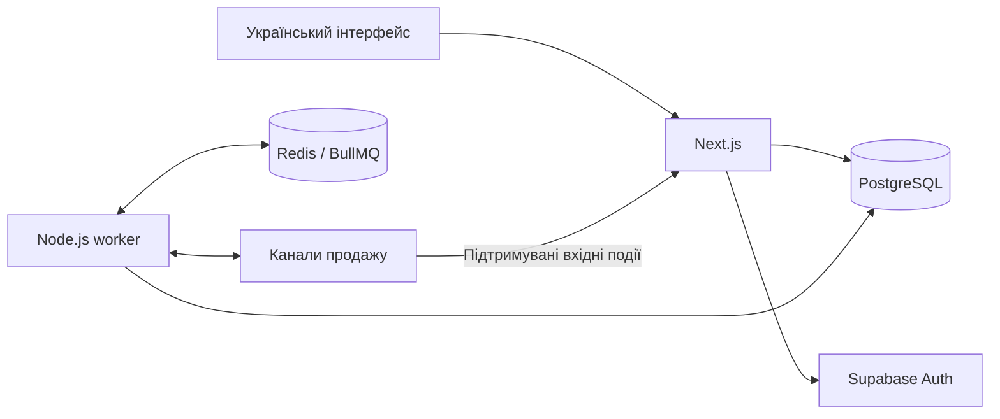

# Архітектура

## Виконання та межі

Модульний моноліт із двома процесами. Next.js і TypeScript обслуговують інтерфейс, серверні команди, HTTP API та вхідні події. Окремий Node.js worker запускає BullMQ для імпорту, синхронізації й reconciliation. PostgreSQL зберігає бізнес-стан, аудит, inbox і outbox. Redis забезпечує виконання черг і ліміти запитів. Втрачені завдання відновлюються за стійкими записами PostgreSQL. Tailwind CSS і shadcn/ui забезпечують спільні токени теми та компоненти.

Модулі експортують команди, запити й доменні події. Замовлення керує життєвим циклом продажу, склад — запасом, каталог — ідентичністю товару, ціни — затвердженими пропозиціями, логістика — відправленнями, фінанси — проведеннями, інтеграції — зовнішнім обміном. Прямі зміни таблиць іншого модуля заборонені. Прикладний сценарій передає спільну транзакцію командам, коли замовлення, запас і фінанси мають змінитися атомарно. Dashboard використовує read models. Для похідних показників з асинхронним оновленням показувати час актуальності.



Outbox записується разом із бізнес-зміною. Relay публікує завдання з детермінованим ID та повторює незавершену доставку. Позначка enqueue не гарантує виконання. Worker фіксує кінцевий результат у PostgreSQL, а періодична перевірка відновлює завислі завдання. Обробники допускають повторну доставку.

## Проєктна структура

```text
apps/
  web/                # App Router, UI, API, прийом подій
  worker/             # BullMQ, планувальники та обробники
packages/
  domain/src/         # Модулі, прикладні команди, порти
    orders/ catalog/ inventory/ pricing/ customers/
    logistics/ finance/ integrations/ identity/
  db/                 # SQL-міграції, транзакції, репозиторії
  adapters/           # Prom.ua, Rozetka, Епіцентр та формати імпорту
  ui/                 # shadcn/ui, тема, спільні компоненти
  config/             # Валідація конфігурації без секретів
infra/                # Dockerfiles, Compose та конфігурація сервісів
tests/                # Міжмодульні, контрактні та наскрізні перевірки
.github/workflows/    # GitHub Actions
docs/
```

Домени залежать від контрактів. PostgreSQL, Redis та зовнішні HTTP-клієнти реалізують ці контракти на інфраструктурному рівні. На старті один PostgreSQL і один пул воркерів. За потреби розділяти воркери за типом навантаження або каналом без зміни власників даних.

## Безпека й експлуатація

- Supabase Auth ідентифікує користувача. Сервер перевіряє сесію, членство в організації й дозвіл на кожну операцію. Початкові ролі охоплюють адміністратора, оператора замовлень, комірника, фінансиста та перегляд. Окремі права потрібні для коригувань, затвердження цін, проведень і ввімкнення зовнішнього запису.
- PostgreSQL доступний серверним процесам. Використовувати окремі ролі для міграцій, web і worker з мінімальними правами. Для бізнес-таблиць застосувати RLS як другий рівень ізоляції з контекстом організації в межах транзакції. Прикладні ролі без `BYPASSRLS`, власності на таблиці й привілейованих ключів Supabase. Міжорганізаційний диспетчер працює з обмеженою службовою чергою, бізнес-операції виконує в контексті конкретної організації. Тестувати доступ до чужих ідентифікаторів і повторне використання з'єднання.
- Секрети ін'єктуються серверу через сховище секретів. База зберігає посилання на credential, а не токен. Логи очищаються від секретів і контактних даних. Аудит містить актора, організацію, дію, ціль, час, причину та ідентифікатор запиту. Для чутливих операцій аудит пишеться в тій самій транзакції.
- Dev, CI, demo, staging і production мають окремі бази, Redis, облікові дані та конфігурацію. Demo використовує синтетичні дані й не має production-доступу. Для dev Docker Compose піднімає локальні залежності. Окремий Supabase-проєкт або локальний Supabase забезпечує Auth. GitHub Actions перевіряє типи, збірку, міграції та тести. Деплой і міграції production потребують окремих прав.
- PostgreSQL потребує резервного копіювання, відновлення до точки в часі та перевірених процедур відновлення. RPO, RTO й терміни зберігання визначає бізнес до запуску. Відстежувати вік outbox, лаг черг, конфлікти резерву, час останньої синхронізації та частоту зовнішніх помилок. Для персональних даних визначити терміни видалення й маскування з урахуванням обов'язкового зберігання операційних записів.

## Реалізація етапу 2

- pnpm workspaces об’єднує два застосунки та пакети `config`, `db`, `domain`, `ui`, `adapters`. Типи ролей та дозволів розташовані в доменному пакеті. UI використовує локальні компоненти, адаптовані з реєстру shadcn/ui New York. Фірмовий червоний доповнено темнішим тоном для читабельності білих написів на кнопках.
- Compose запускає один PostgreSQL, Redis, Supabase Auth (GoTrue) та шлюз зі стандартним шляхом `/auth/v1`. Auth і CRM використовують різні схеми однієї бази. Порти публікуються лише на loopback. Публічна реєстрація вимкнена. Dev і test мають окремі порти, томи, згенеровані секрети й Redis-префікси.
- Next.js оновлює cookie через proxy. Сервер перевіряє користувача через Auth, активне членство й дозволи через PostgreSQL. Cookie має `HttpOnly`, `SameSite=Lax` і `Secure` під HTTPS. Вихід завершує локальну сесію. Налаштування читають власник і адміністратори. Керування користувачами й скидання пароля відкладено.
- Локальні лаунчери вилучають ключі міграцій та провізіонування з оточення web і worker. Режим production вимагає HTTPS для Auth, перевірений TLS для PostgreSQL і захищене автентифіковане підключення до Redis. Етап перевіряє production-збірку на ізольованих локальних сервісах. Реальне розгортання й політики Auth production потребують окремого налаштування.
- BullMQ виконує синтетичне завдання `smoke` у development і test. Ключ PostgreSQL робить його ефект ідемпотентним навіть при різних ID доставки. Черга зберігає кінцевий стан із терміном зберігання та обмежує кількість спроб. Транзакційний outbox залишається наступним кроком для бізнес-завдань.
